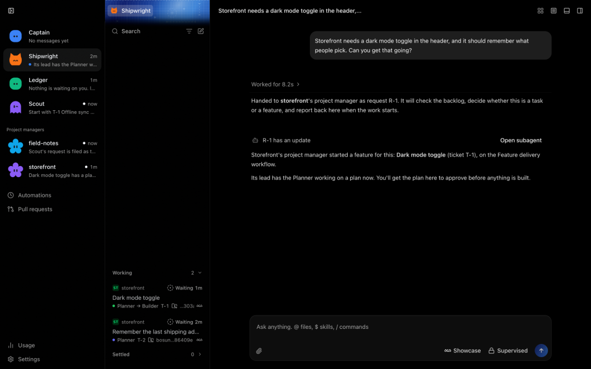
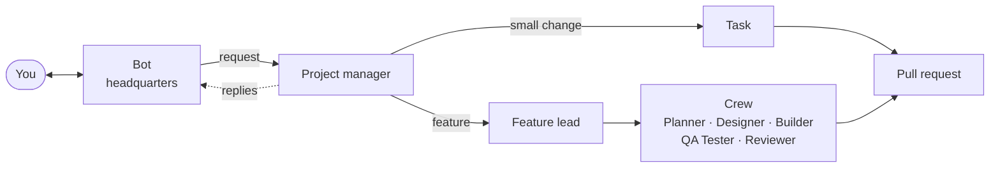
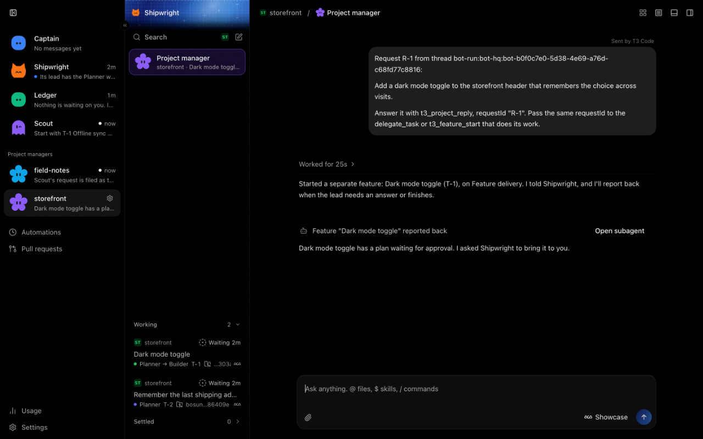
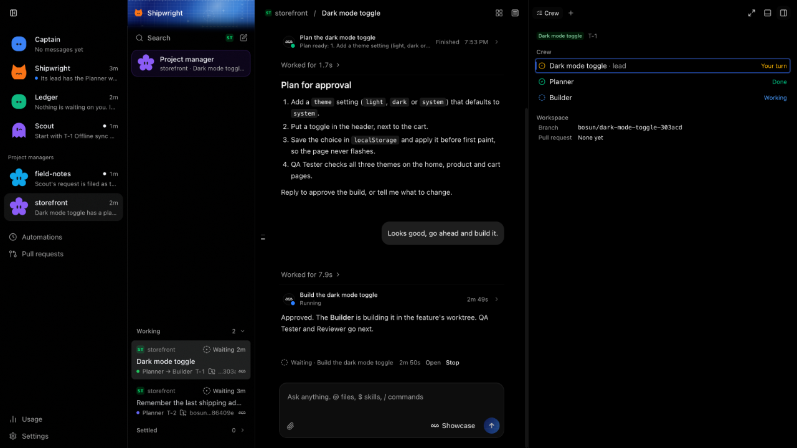
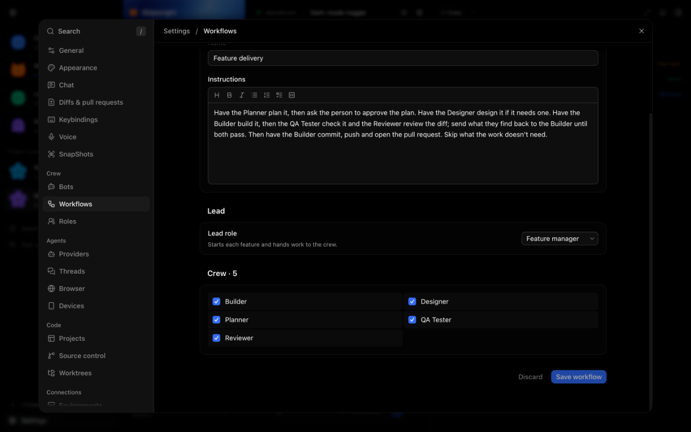

# Bosun

Bosun is an open-source **agentic software factory**. Instead of driving one coding agent
at a time, you talk to **bots**. Each bot owns a set of projects, each project has a
**project manager** that turns your requests into tracked work, and bigger work runs as
**features**: a lead and a crew of roles working in their own branch toward one pull request.

Bosun is a downstream fork of [T3 Code](#the-t3-code-harness) and uses it as its agent
harness and control surface. The name comes from _boatswain_ ("bosun"): the officer
who runs the deck crew under the captain.

## Credit where it's due

Bosun stands entirely on [T3 Code](https://github.com/pingdotgg/t3code), built by
[T3 Tools](https://t3.codes) — Theo Browne, Julius Marminge, and the T3 Code
contributors.

- **All credit for the underlying harness goes to the T3 Code team.** The agent
  subprocesses, provider adapters, orchestration engine, desktop/web/mobile clients,
  and everything that makes agents actually run are their work, not ours.
- Bosun would not exist without T3 Code, and we intend to keep merging upstream in as
  they ship it (see [`BOSUN.md`](./BOSUN.md)).
- T3 Code is MIT-licensed (`LICENSE`, © T3 Tools Inc.). We keep their copyright and
  permission notice intact.

Bosun is an independent project. It is **not affiliated with or endorsed by T3 Tools**,
and it ships under its own name, identity, and branding.

## What is Bosun?



- **Bots** own your projects. Each one has a **headquarters** thread where you ask for
  work, a home folder for its notes, its own model, tools and access, and an avatar you
  build from parts. Every environment starts with **Captain**; add more, such as one per
  area of your life or work. Scheduled tasks (**Automations**) can run as a bot too.
- **The bot list** runs down the left edge: your bots first, then your project managers,
  each with its latest message and whether it's working or needs you.
- **Project managers**: each project has one. It takes the requests its bot hands it,
  checks the backlog and files an issue or ticket when nothing tracks the request, then decides how
  the work runs: a **task** for a small, clear change, a **feature** for one reviewable
  pull request, or several features for bigger work. It replies in the bot's headquarters
  when work starts, when it needs an answer and when it's done.
- **Features** are one worktree, one branch and one pull request. A **workflow** decides
  who leads a feature and which crew roles it can hand work to. The default, **Feature
  delivery**, is led by a Feature manager with a Planner, Designer, Builder, QA Tester and
  Reviewer, and asks you to approve the plan before anything is built. **Epic** splits big
  work into child features; a child that builds on another starts from its branch, so the
  pull requests stack.
- **Issues and tickets**: every piece of work can trace back to a GitHub issue or a Bosun
  ticket (`T-1`, `T-2`, …). Threads show their issue in an **Issue** tab, and a pull
  request's summary lists the issues it closes. The **board** shows every feature and todo
  across your projects.
- **More than one machine**: a bot's projects can live on any connected environment, and
  with linked environments (beta) agents on one machine can hand work to another.

### How work flows



You can also ask a bot to start a task or feature itself, or start a feature yourself
from the board.



_Pick a project and its project manager sits at the top of the thread list, above that
project's features._



_A feature's lead hands work to its crew. The **Crew** tab shows each member's state and
the feature's branch and pull request._



_Bots, workflows and roles live in **Settings → Crew**._

Read more in [Bots and roles](./docs/user/bots.md) and [Features](./docs/user/features.md).

## Status

Early, and moving fast. Bosun follows T3 Code closely and adds the bots, project managers,
features and crews described above on top. Expect rough edges.

## The T3 Code harness

Everything below describes the upstream harness Bosun is built on. Bosun does not
publish its own builds yet; until it does, you can run the upstream T3 Code it is
based on.

T3 Code is an "agent harness control surface". It enables control of the agents on
your machine with a best-in-class mobile app ([iOS](https://apps.apple.com/us/app/t3-code-remote-claude-more/id6787819824),
[Android](https://play.google.com/store/apps/details?id=com.t3tools.t3code)),
[web app](https://app.t3.codes) and [Electron-based desktop app](https://t3.codes).

Works with your subscriptions on Claude Code, Codex, Cursor, Grok Build, OpenCode,
Google Antigravity, and fx. If they're set up on your computer, T3 Code can control them.

### Installation

> [!WARNING]
> The harness currently supports Codex, Claude, Cursor, Grok Build, OpenCode,
> Antigravity, and fx. Install and authenticate at least one provider before use:
>
> - Codex: install [Codex CLI](https://developers.openai.com/codex/cli) and run `codex login`
> - Claude: install [Claude Code](https://claude.com/product/claude-code) and run `claude auth login`
> - Cursor: install [Cursor CLI](https://cursor.com/cli) and run `agent login`
> - Grok Build: install [Grok Build CLI](https://x.ai/cli) and run `grok login`
> - OpenCode: install [OpenCode](https://opencode.ai) and run `opencode auth login`
> - Antigravity: enable it in Settings, then use **Install Antigravity** and **Sign in with Google**. No CLI is required.
> - fx: install [fx](https://fx.sh) and run `fx login` on the machine running the T3 Code server ([setup guide](./docs/user/providers-fx.md))

### Command line

```bash
curl -fsSL https://t3.codes/install.sh | sh
```

On Windows, in PowerShell:

```powershell
irm https://t3.codes/install.ps1 | iex
```

Then run `t3` to start the server and open the local web app. `t3 service install`
keeps it running in the background, `t3 update` moves to a newer release, and
`t3 --help` has the full reference.

To try it once without installing, run `npx t3@latest`. It offers to install the `t3` command for you.

### Desktop app

Install the latest T3 Code desktop app from
[GitHub Releases](https://github.com/pingdotgg/t3code/releases), or from your favorite
package registry:

#### Windows (`winget`)

```bash
winget install T3Tools.T3Code
```

#### Windows (`scoop`)

```bash
scoop install extras/t3code
```

#### macOS (Homebrew)

```bash
brew install --cask t3-code
```

#### Debian, Ubuntu (`.deb`)

Download the `.deb` from [GitHub Releases](https://github.com/pingdotgg/t3code/releases),
then:

```bash
sudo apt install ./T3-Code-*.deb
```

#### Arch Linux (AUR)

Stable:

```bash
yay -S t3code-bin
```

Nightly:

```bash
yay -S t3code-nightly-bin
```

The AUR packaging is maintained in the upstream repository under
[`packaging/aur`](./packaging/aur).

#### Nix (nixpkgs)

```bash
nix profile add github:NixOS/nixpkgs/nixos-unstable#t3code
```

The package is maintained in [nixpkgs](https://github.com/NixOS/nixpkgs/tree/nixos-unstable/pkgs/by-name/t3/t3code)
and includes the desktop app (`t3code-desktop`) and the `t3` command.
See [Nix installation](./docs/user/install.md#nix-nixpkgs) for NixOS configuration and updates.

## Documentation

Full docs live in [docs/](./docs).

Bosun:

- [Bots, project managers and roles](./docs/user/bots.md)
- [Features, the board, issues and tickets](./docs/user/features.md)
- [Link another environment](./docs/user/remote-access.md#link-another-environment)

From T3 Code:

- [FAQ](./docs/user/faq.md)
- [Install and first run](./docs/user/install.md)
- [Permission modes](./docs/user/permission-modes.md)
- [Keyboard shortcuts](./docs/user/keybindings.md)
- [Project settings](./docs/user/project-settings.md)
- [Appearance preferences](./docs/user/appearance.md)
- [Remote access from a phone or another machine](./docs/user/remote-access.md)
- [Connect Claude Code, Codex, ChatGPT and other agents over MCP](./docs/user/outside-agents.md)
- [Keeping app and server in sync](./docs/user/updating.md)
- [Source control integrations](./docs/user/source-control.md)
- Multiple accounts: [Codex](./docs/user/providers-codex.md) · [Claude](./docs/user/providers-claude.md)
- [Run T3 Code as a background service](./docs/user/background-service.md)

Building from source? Start at [docs/internals/overview.md](./docs/internals/overview.md)
and read [`BOSUN.md`](./BOSUN.md) for Bosun's branch model and upstream sync.

### Install `vp`

Bosun (like T3 Code) uses Vite+, so you'll need the global `vp` command-line tool.

#### macOS / Linux

```bash
curl -fsSL https://vite.plus | bash
```

#### Windows

```powershell
irm https://vite.plus/ps1 | iex
```

Then install dependencies:

```bash
vp i
```

## Contributing

Bosun is open source and contributions are welcome. See
[`CONTRIBUTING.md`](./CONTRIBUTING.md) before reporting a bug or opening a PR, and
[`BOSUN.md`](./BOSUN.md) for the branch model.

Because Bosun builds on T3 Code, fixes that belong upstream are best sent to
[T3 Code](https://github.com/pingdotgg/t3code) directly; Bosun-specific work goes here.

## License

MIT. Bosun is a fork of T3 Code and inherits its license: see [`LICENSE`](./LICENSE),
© T3 Tools Inc. Keep that copyright and permission notice, along with the third-party
notices. MIT does not grant trademark rights in the "T3 Code" or "T3 Tools" names or
logos, which remain the property of their owners.
